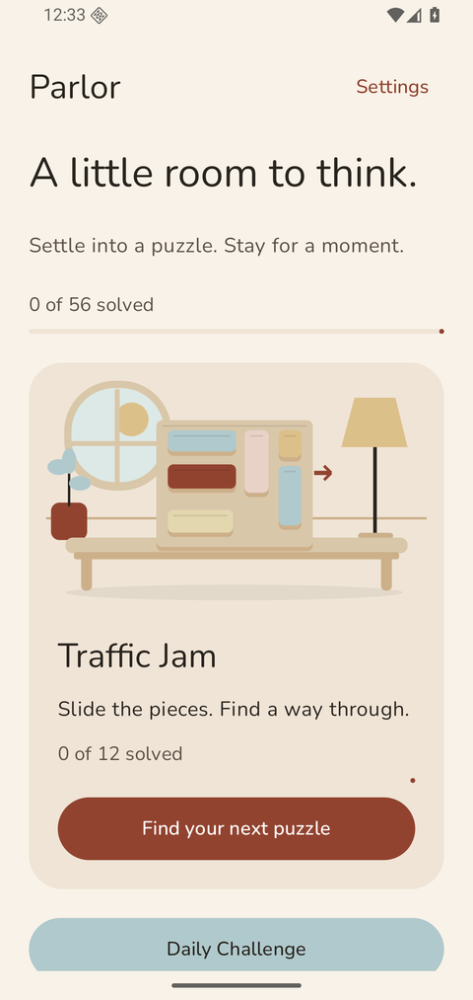
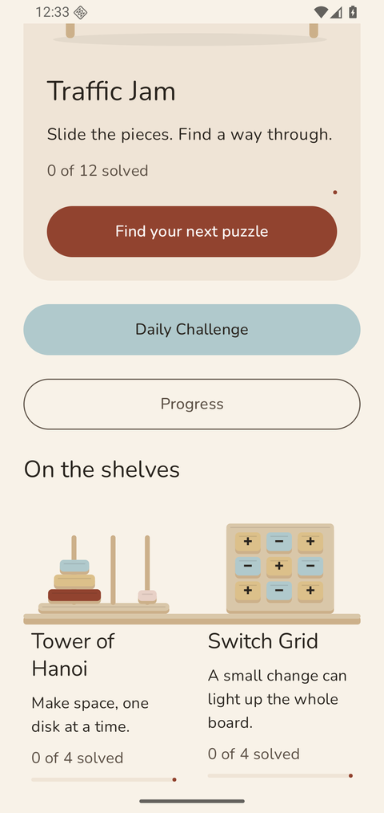
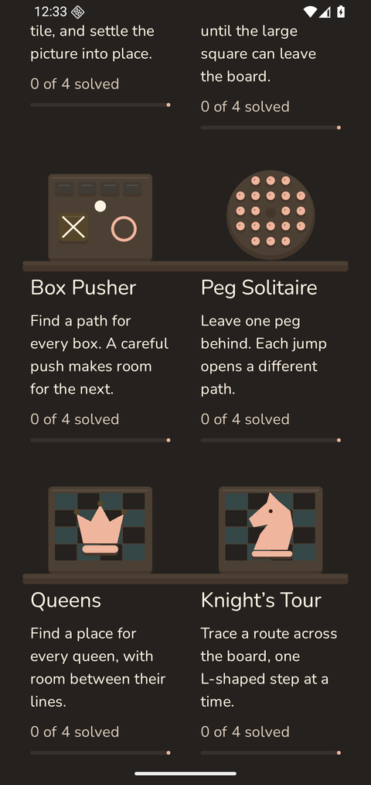
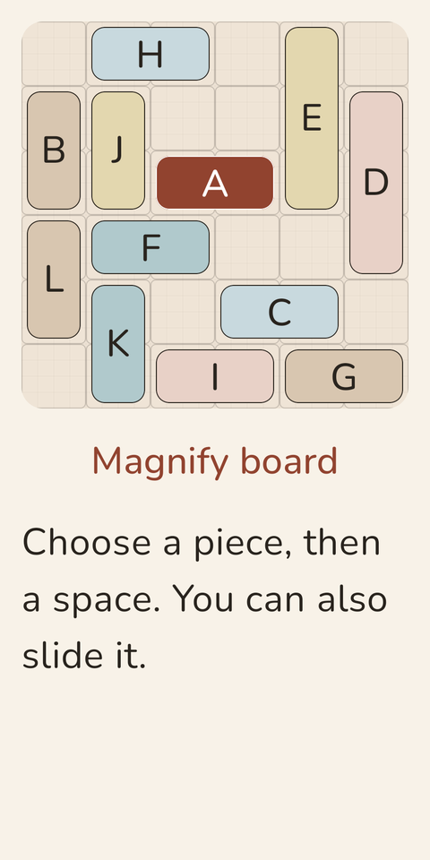
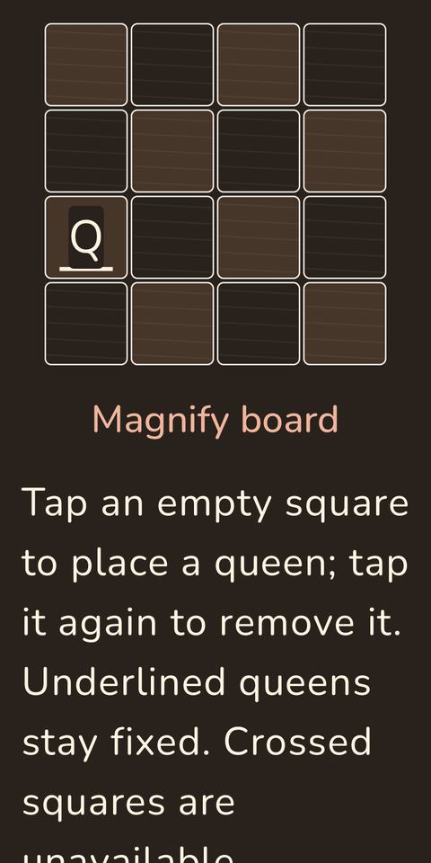
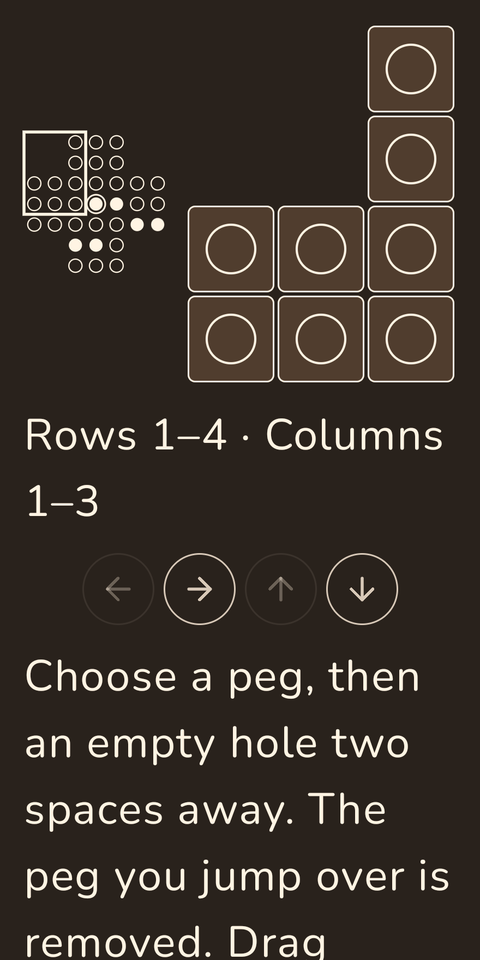
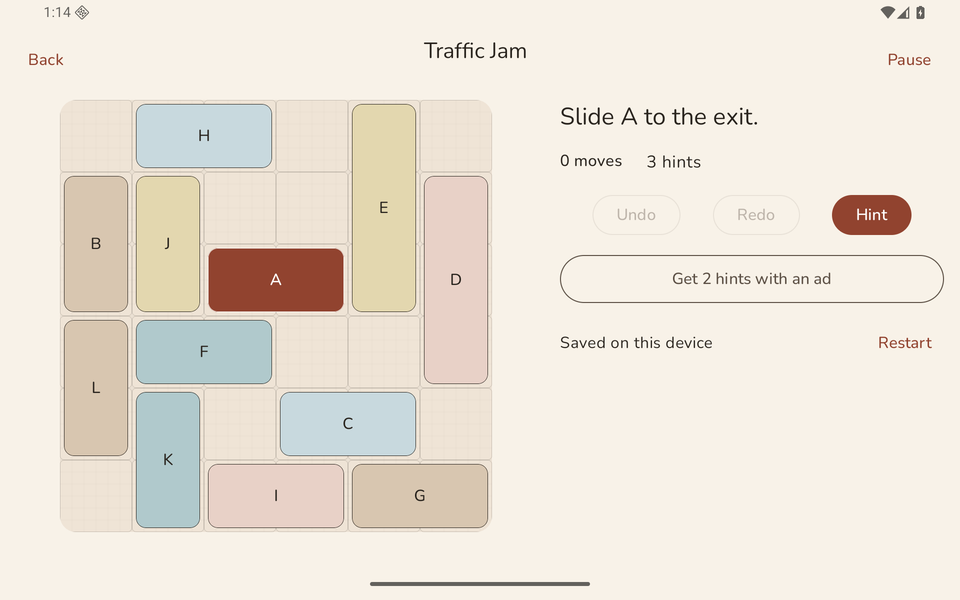

<div align="center">
  
  <h1>Parlor Puzzles</h1>
  <p><strong>A little room to think. Every room is yours.</strong></p>
  <p>Twelve classic logic puzzles. One calm Android app.<br>Free to download. Free to play. Every feature included.</p>
  <p>
    
    
    
    
    
  </p>
  <p><a href="#the-puzzles">Meet the puzzles</a> · <a href="#make-yourself-at-home">Features</a> · <a href="#build-and-play">Build and play</a> · <a href="docs/FREE_EDITION.md">Free edition notes</a></p>
</div>

<table>
<tr>
<td></td>
<td></td>
<td></td>
</tr>
</table>

A good puzzle needs space, a clear set of rules, and a satisfying moment when it clicks. Parlor Puzzles brings twelve families together with large touch targets, thoughtful tutorials, solver-backed hints, and a place for every move you make.

**No ads. No purchases. No subscriptions. No account.** All puzzle difficulties and variants, all six room palettes, photo tiles, backups, demonstrations, detailed history, unlimited hints, and unlimited scored Daily retries are included. Nothing needs a store connection to unlock.

> **Project status:** this is a development prototype with **56 verified sample levels across all twelve families**. The planned 556-level launch catalog and physical-device release qualification are unfinished. Making every existing feature free does not turn the prototype into a certified store release. See [release readiness](docs/FREE_EDITION.md#release-readiness).

## The puzzles

| Puzzle | Your moment of clarity |
| --- | --- |
| **Traffic Jam** | Make a path and slide the red piece to the exit. |
| **Tower of Hanoi** | Move the tower without resting a larger disc on a smaller one. |
| **Switch Grid** | Flip the right switches until every light is on. |
| **Water Jugs** | Measure an exact amount with an unlikely set of containers. |
| **Pancake Flip** | Put the stack in order using only flips from the top. |
| **Sliding Tiles** | Settle the picture into place—or turn your own photo into a puzzle. |
| **Block Escape** | Untangle the blocks and guide the large square out. |
| **Box Pusher** | Push every box onto a target without trapping yourself. |
| **Peg Solitaire** | Jump your way down to one remaining peg. |
| **Queens** | Give every queen a square with no one in the line of attack. |
| **Knight’s Tour** | Visit every square with the knight’s distinctive L-shaped steps. |
| **Crossings** | Get everyone across the river while respecting each scenario’s rules. |

Every bundled level includes a verified solution. Every family has an interactive tutorial and a worked demonstration. Hints use the game’s actual solver; undo and redo let you explore another approach.

<table>
<tr>
<td></td>
<td></td>
<td></td>
</tr>
</table>

## Make yourself at home

- **Pick any puzzle.** All bundled levels, difficulty tiers, and former paid variants are available from the start.
- **Take all the help you need.** Unlimited hints, unlimited scored Daily retries, and solution demonstrations. Hints still affect scoring; being free does not change the puzzle rules.
- **Keep your place.** Moves, bests, attempts, and settings save locally. Leave halfway through a board and resume it later.
- **Find your room.** Linen, Amber, Rose, Sage, Slate, and Walnut, each with light, dark, or device-controlled appearance.
- **Make a picture personal.** Choose a photo for Sliding Tiles with Android’s photo picker; the app keeps a bounded local copy.
- **Bring your progress along.** Manual backup and restore, complete attempt history, filters, stars, points, streaks, and 40 achievements.
- **Play comfortably.** Reduced motion, optional haptics and sound, large text, accessible home navigation, and layouts for phones, tablets, and foldables.
- **Return when you want.** Optional Daily and streak reminders at a time you choose.



Screenshots show existing development builds. Some older captures and historical documents predate the free edition.

## Build and play

You need **JDK 17**, Android SDK **platform 36**, build tools **35.0.0**, and an Android 8.0+ device or emulator. Android Studio is the easiest starting point.

```sh
git clone https://github.com/VincentAZ/parlor-puzzles.git
cd parlor-puzzles
# Set ANDROID_HOME, or put sdk.dir=/your/android/sdk in local.properties.
./gradlew :app:assembleDebug
adb install -r app/build/outputs/apk/debug/app-debug.apk
```

The debug package is `com.parlor.puzzles.debug`. It coexists with the production package and needs **no billing key, ad account, or purchase-verification service**. Debug and release use the same free feature policy.

A release build still requires the complete launch catalog, signing, and the existing Firebase crash-reporting configuration. These are release-readiness requirements, never feature unlocks. There is no download charge in this source project; Google Play pricing and a published update must be managed separately in Play Console.

## Built for moves that matter

| Layer | Responsibility |
| --- | --- |
| `core/model` | Serializable boards, moves, settings, attempts, and stable save formats |
| `core/game` | Twelve puzzle engines, move validation, solvers, and reference-solution verification |
| `core/progress` | Scoring, Daily scheduling, streaks, achievements, and unrestricted access rules |
| `core/data` | Room persistence, transactions, backups, photos, and damaged-save recovery |
| `core/design` | Room palettes, responsive layouts, typography, and fold-safe UI primitives |
| `core/platform` | Sound, haptics, local reminders, and configured crash reporting; no ad or billing SDK |
| `feature/library` · `feature/play` | Home, collections, history, settings, boards, tutorials, and demonstrations |
| `tools/levels` | Original level generation and catalog verification |

An accepted move is committed before its animation finishes. The save schema stays compatible with earlier builds: old paid flags and reward records cannot restrict play, and old progress does not need to be reset.

### Check your changes

```sh
./gradlew :core:model:test :core:game:test :core:progress:test
./gradlew :tools:levels:verifyPrototype
./gradlew :app:testDebugUnitTest :app:assembleDebug
# With a connected device or emulator:
./gradlew :app:connectedDebugAndroidTest
```

Gradle, Kotlin, AGP, and dependencies are pinned; Maven artifacts use checksum verification. Keep solver and migration tests passing when changing gameplay or saves.

## Privacy and contributions

Gameplay and progress work locally without an account. Photos use the system picker; reminders are opt-in. Ads, ad consent, payment processing, and purchase verification are absent. The existing configured release crash reporter is separate from gameplay; see [crash reporting](docs/CRASH_REPORTING.md).

Found a bug or have a puzzle idea? [Open an issue](https://github.com/VincentAZ/parlor-puzzles/issues). Include the puzzle, level, device, and steps to reproduce; keep personal photos and backup files out of public reports. For contributions, start with a focused change and its relevant tests.

Code is available under the [MIT license](LICENSE). See [asset provenance](docs/ASSET_PROVENANCE.md) and bundled font licenses for asset-specific terms.
